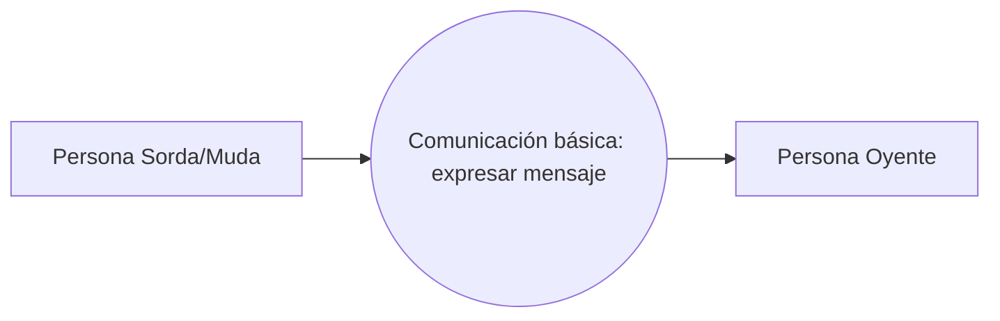

# Proceso de negocio 1 — Comunicación básica: sordo hacia oyente

La persona sorda/muda comunica expresiones de uso frecuente, como saludos, presentaciones y lenguaje básico. El proceso es independiente de la existencia de un software.

**Referencia de origen:** documento SICOB, sección IV-A, Fig. 1.