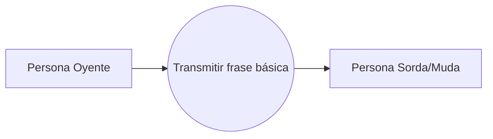

# Proceso de negocio 2 — Comunicación básica: oyente hacia sordo

La persona oyente transmite una frase básica a la persona sorda mediante Lengua de Señas. Es el proceso inverso al anterior.

**Referencia de origen:** documento SICOB, sección IV-B, Fig. 2.