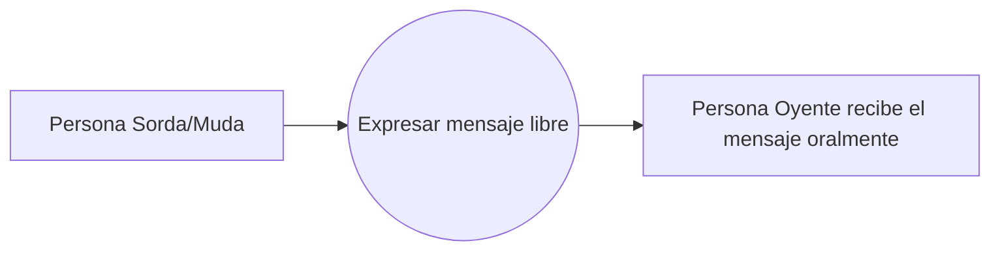

# Proceso de negocio 3 — Comunicación compleja

Este proceso cubre mensajes que no pueden resolverse con frases básicas predefinidas.

**Referencia de origen:** documento SICOB, sección IV-C, Fig. 3.