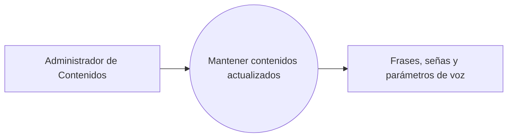

# Proceso de negocio 4 — Gestión de contenidos

El administrador mantiene actualizado el repertorio de frases, señas y parámetros de voz que apoyan los procesos de comunicación.

**Referencia de origen:** documento SICOB, sección IV-D, Fig. 4.