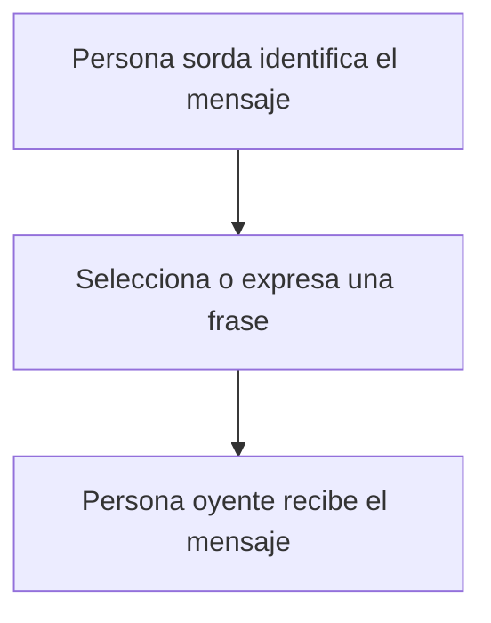
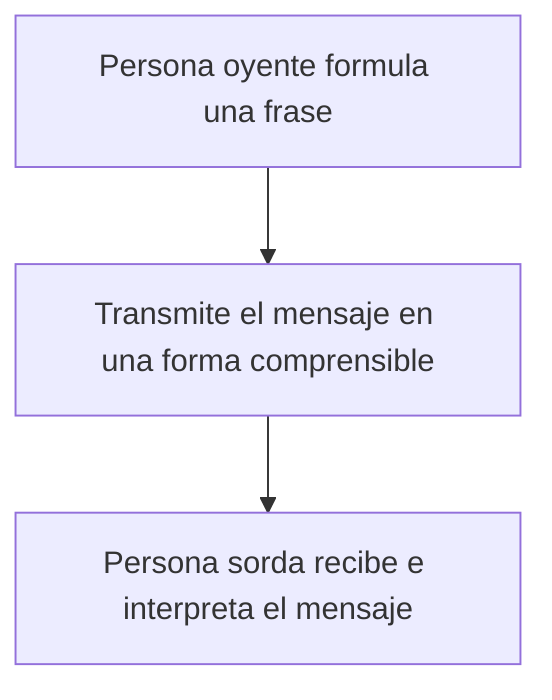
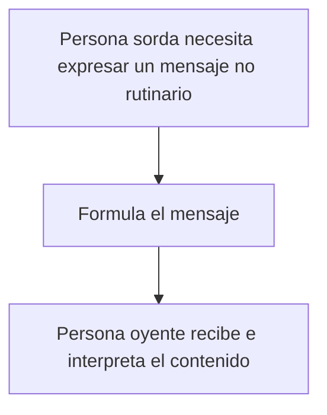
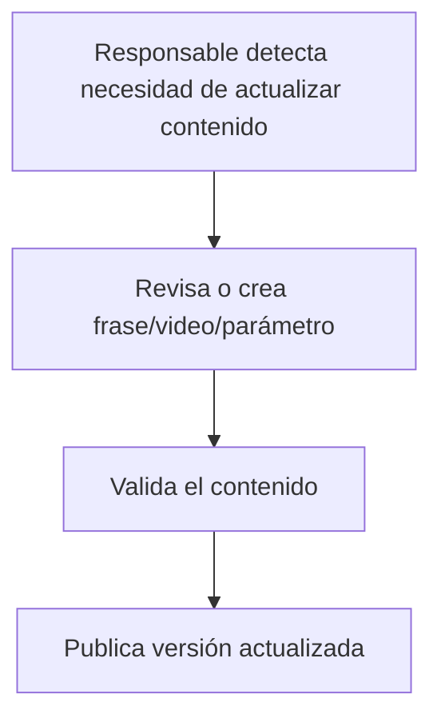
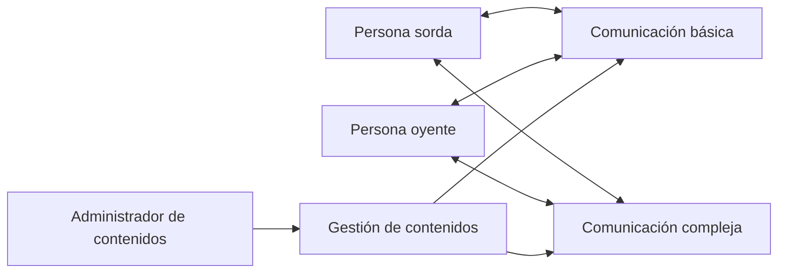

# Modelo de negocio SICOB

Los diagramas siguientes representan procesos de comunicación independientes de la solución informática. Son hipótesis iniciales que deben contrastarse con el cliente.

## Proceso 1 — Comunicación básica: persona sorda hacia persona oyente

**Descripción:** intercambio cotidiano de saludos, presentaciones y expresiones frecuentes.

## Proceso 2 — Comunicación básica: persona oyente hacia persona sorda

**Descripción:** comunicación inversa, que puede requerir una representación visual en LSC.

## Proceso 3 — Comunicación compleja

**Descripción:** situaciones que no se resuelven con expresiones predefinidas.

## Proceso 4 — Gestión de contenidos

**Descripción:** mantenimiento del catálogo para conservar utilidad y adecuación del contenido.

## Vista general de procesos

