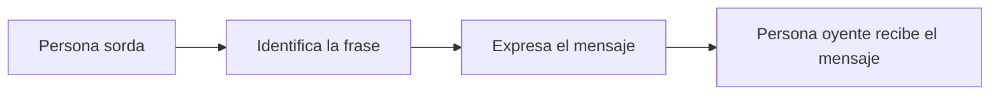

# Proceso de negocio 1: Comunicación básica (persona sorda hacia persona oyente)

**Descripción:** intercambio de saludos, presentaciones y frases frecuentes. Este diagrama describe el proceso de negocio, sin depender de una solución informática.