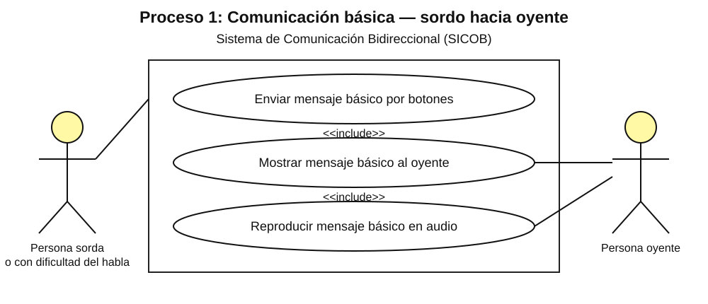

# CU-01 — Comunicación básica: persona sorda hacia persona oyente

**Caso de uso:** Enviar Mensaje Básico por Botones.  
**Actor:** Persona Sorda/Muda.

La persona abre el panel de botones básicos, selecciona el mensaje deseado y SICOB identifica el mensaje asociado. A continuación, el sistema muestra el mensaje y reproduce el mensaje básico en audio.

## Flujo paso a paso
1. La persona sorda abre el panel de botones básicos.
2. Selecciona el botón correspondiente al mensaje deseado.
3. El sistema identifica el mensaje asociado al botón.
4. El sistema muestra el mensaje al oyente y reproduce el mensaje en audio.

**Referencia de origen:** documento SICOB, sección V-A, Fig. 5.

## Imagen del diagrama

