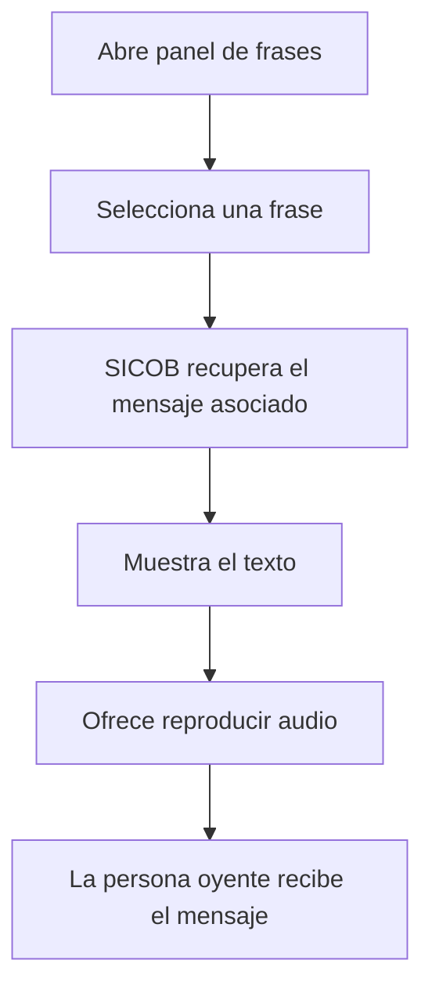

# CU-01 — Enviar mensaje básico por botones

**Actor:** persona sorda o con dificultad del habla.

**Alternativa:** si el audio no está disponible, el texto permanece visible. **Resultado:** mensaje básico presentado.