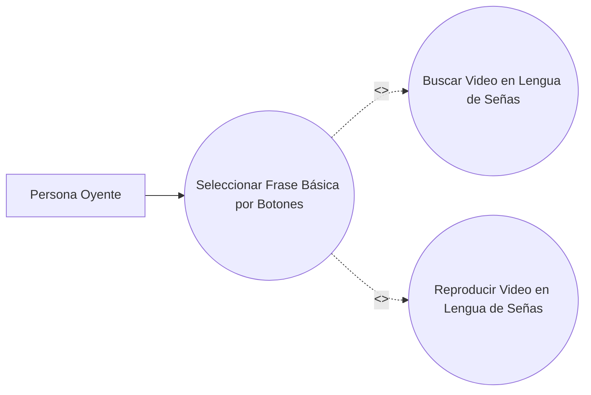

# CU-02 — Comunicación básica: persona oyente hacia persona sorda

**Caso de uso:** Seleccionar Frase Básica por Botones.  
**Actor:** Persona Oyente.

La persona oyente abre el panel de botones básicos y selecciona una frase. SICOB busca el video en Lengua de Señas y lo reproduce para transmitir el mensaje a la persona sorda.

## Diagrama del caso de uso

## Flujo paso a paso
1. La persona oyente abre el panel de botones básicos.
2. Selecciona el botón correspondiente.
3. El sistema busca el video en Lengua de Señas.
4. El sistema reproduce el video en Lengua de Señas.

**Referencia de origen:** documento SICOB, sección V-B, Fig. 6.