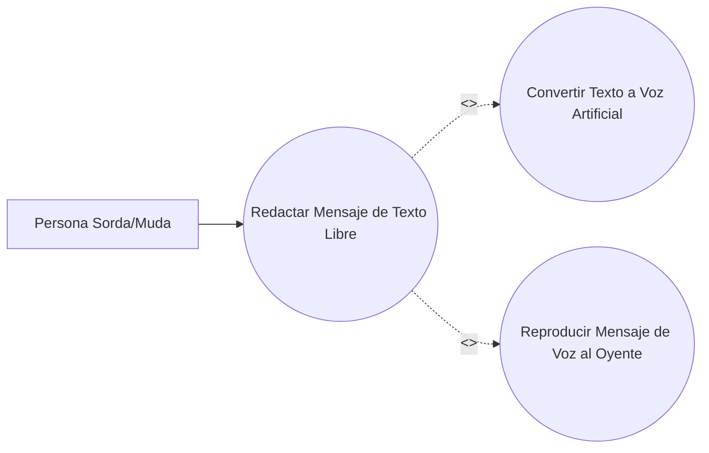

# CU-03 — Comunicación compleja (texto a voz)

**Caso de uso:** Redactar Mensaje de Texto Libre.  
**Actor:** Persona Sorda/Muda.

La persona sorda abre el módulo de comunicación compleja y redacta un mensaje que no está cubierto por los botones básicos. El sistema convierte el texto a voz artificial y reproduce el mensaje para la persona oyente.

## Diagrama del caso de uso

## Flujo paso a paso
1. La persona sorda abre el módulo de comunicación compleja.
2. Redacta el mensaje de texto libre.
3. El sistema convierte el texto a voz artificial.
4. El sistema reproduce el mensaje de voz al oyente.

**Referencia de origen:** documento SICOB, sección V-C, Fig. 7.