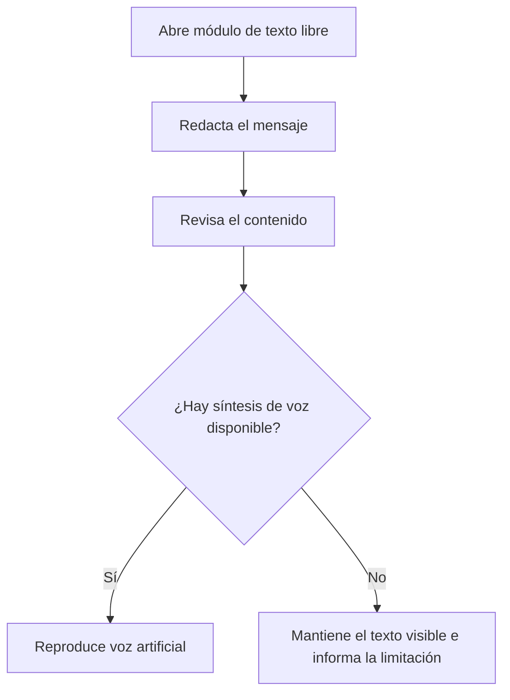

# CU-03 — Redactar texto libre y reproducir voz

**Actor:** persona sorda o con dificultad del habla.

**Resultado:** el mensaje queda disponible en texto y, si el dispositivo lo permite, en voz. Este caso de uso no representa traducción automática a LSC.