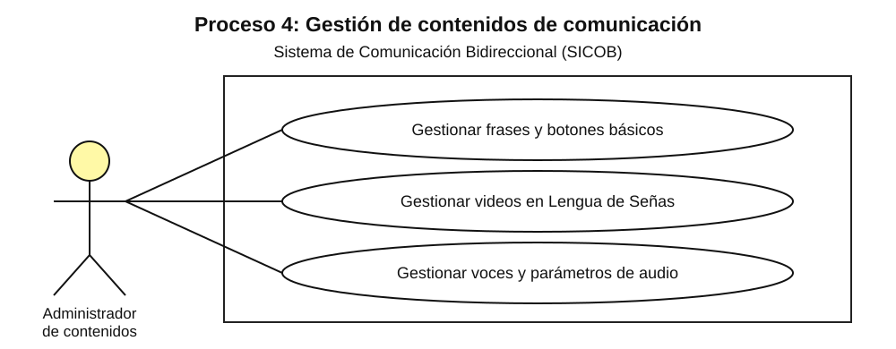

# CU-04 — Gestión de contenidos de comunicación

**Caso de uso:** Gestionar Frases y Botones Básicos.  
**Actor:** Administrador de Contenidos.

El administrador ingresa al módulo de gestión, selecciona el elemento que necesita mantener y agrega, modifica o elimina frases, botones básicos, videos en Lengua de Señas o parámetros del motor de voz. SICOB guarda y publica los cambios.

## Flujo paso a paso
1. El administrador ingresa al módulo de gestión de contenidos.
2. Selecciona la opción a gestionar.
3. Agrega, modifica o elimina el elemento correspondiente.
4. El sistema guarda los cambios y los publica para personas sordas y oyentes.

**Referencia de origen:** documento SICOB, sección V-D, Fig. 8.

## Imagen del diagrama

