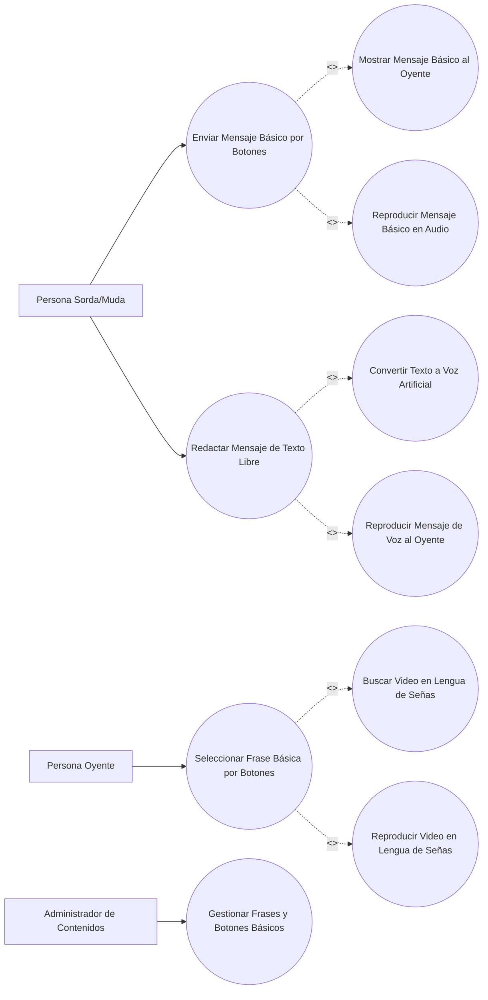
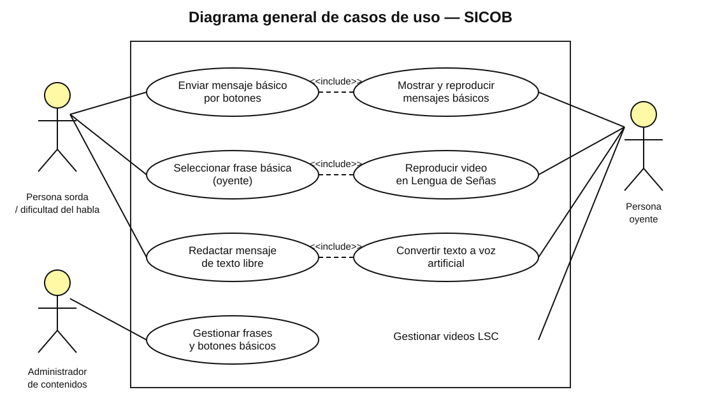

# Diagrama general de casos de uso — SICOB

Este diagrama reúne los cuatro casos de uso descritos en el documento del proyecto y los tres actores identificados.

## Actores
- Persona Sorda/Muda.
- Persona Oyente.
- Administrador de Contenidos.

**Referencia de origen:** documento SICOB, sección VI, Fig. 9.

## Imagen del diagrama

