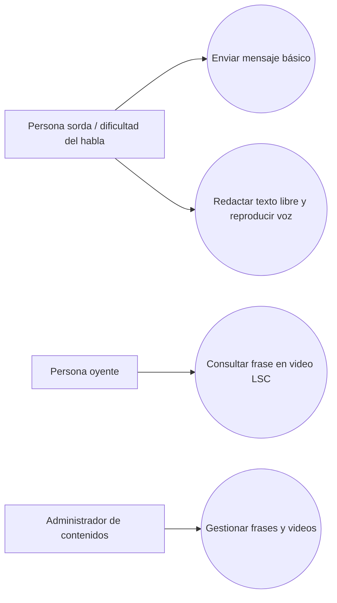

# Modelo de requerimientos SICOB

Estos casos de uso describen cómo el software podría apoyar los procesos de negocio. Son preliminares y deben ajustarse tras la entrevista.

## CU-01 — Enviar mensaje básico por botones
**Actor:** persona sorda o con dificultad del habla.  
**Precondición:** el catálogo de frases está disponible.  
**Flujo:** 1) abre el panel; 2) selecciona una frase; 3) el sistema recupera el texto asociado; 4) muestra el mensaje y ofrece reproducirlo en voz.  
**Alternativa:** si el audio no está disponible, el mensaje textual permanece visible.  
**Resultado:** el mensaje queda presentado a la persona oyente.

## CU-02 — Seleccionar frase para verla en LSC
**Actor:** persona oyente.  
**Precondición:** existe un clip validado asociado a la frase.  
**Flujo:** 1) abre el panel; 2) selecciona frase; 3) el sistema busca el clip asociado; 4) reproduce el video.  
**Alternativa:** si no existe clip, el sistema informa que la frase no está disponible en el catálogo.  
**Resultado:** se presenta el clip vinculado a la frase.

## CU-03 — Redactar mensaje libre y reproducir voz
**Actor:** persona sorda o con dificultad del habla.  
**Precondición:** el navegador o dispositivo dispone de síntesis de voz compatible.  
**Flujo:** 1) abre comunicación libre; 2) escribe un mensaje; 3) revisa el texto; 4) solicita reproducirlo; 5) el sistema lee el mensaje.  
**Alternativa:** si no existe soporte de voz, el texto permanece disponible y se informa la limitación.  
**Resultado:** mensaje escrito y, si es compatible, reproducido en voz.  
**Nota:** esto es texto a voz, no traducción automática a LSC.

## CU-04 — Gestionar contenidos
**Actor:** administrador de contenidos.  
**Precondición:** cuenta autorizada (la autenticación real está fuera de la maqueta).  
**Flujo:** 1) entra a gestión; 2) selecciona tipo de contenido; 3) crea, modifica o elimina; 4) revisa y valida; 5) guarda cambios.  
**Resultado:** catálogo actualizado.

## Diagrama general de casos de uso

## Requisitos funcionales iniciales
- RF1: seleccionar frases predefinidas.
- RF2: mostrar el mensaje y permitir reproducción de voz.
- RF3: seleccionar una frase desde la interfaz de persona oyente.
- RF4: reproducir un video LSC asociado a la frase.
- RF5: redactar texto libre.
- RF6: convertir texto a voz cuando el dispositivo lo soporte.
- RF7: administrar frases.
- RF8: administrar videos LSC.
- RF9: configurar opciones de voz compatibles.

## Requisitos no funcionales iniciales
- RNF1: interfaz adaptable a navegador de escritorio y móvil.
- RNF2: objetivo preliminar de iniciar reproducción en menos de 2 segundos en condiciones normales; validar con el cliente.
- RNF3: navegación clara, controles distinguibles y accesibilidad.
- RNF4: disponibilidad objetivo del 99% solo si la arquitectura y el entorno lo permiten; debe negociarse.
- RNF5: catálogo ampliable.
- RNF6: soporte inicial de LSC con contenidos validados.

## Casos de uso organizados por subcarpetas

Cada carpeta contiene la descripción, el flujo paso a paso y una imagen SVG del diagrama correspondiente.

1. [CU-01 — Comunicación básica: persona sorda hacia oyente](./CU01_Comunicacion_Basica_Sordo_Oyente/)
2. [CU-02 — Comunicación básica: persona oyente hacia sorda](./CU02_Comunicacion_Basica_Oyente_Sordo/)
3. [CU-03 — Comunicación compleja: texto a voz](./CU03_Comunicacion_Compleja_Texto_a_Voz/)
4. [CU-04 — Gestión de contenidos](./CU04_Gestion_Contenidos/)
5. [Diagrama general de casos de uso](./Diagrama_General_Casos_de_Uso/)

